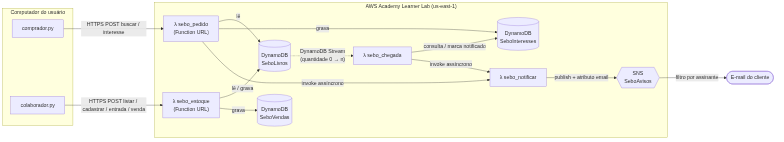
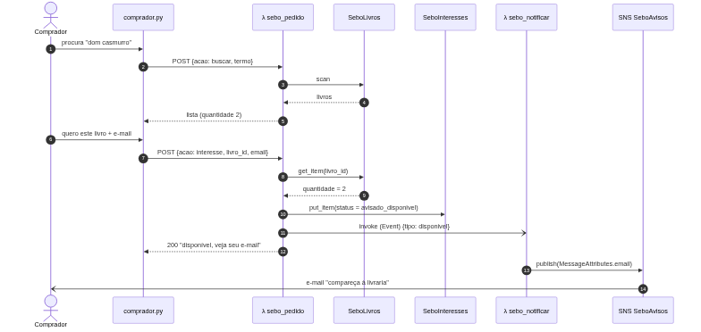

<!-- Modelo: as seções 1 a 6 descrevem o que já está no código. As marcadas com [PREENCHER]
dependem do que acontecer na AWS: escrever só o que foi visto funcionando, com print ou log. -->

# 1. Onde está o trabalho

- **Conta AWS Academy:** Learner Lab do aluno **Eduardo Vasques Zacour** (eduardo.zacour@gmail.com), curso *AWS Academy Learner Lab* [183838], região **us-east-1**.
- **Repositório:** https://github.com/eduardozacour/sebo-aws (público).
- **Recursos criados:** Lambdas `sebo_pedido`, `sebo_estoque`, `sebo_chegada`, `sebo_notificar`; tabelas DynamoDB `SeboLivros`, `SeboInteresses`, `SeboVendas`; tópico SNS `SeboAvisos`.

# 2. O que foi implementado

Uma livraria no estilo sebo, sem servidor próprio. O comprador procura um livro pela interface e informa o e-mail.

- **Livro disponível:** o comprador recebe na hora um e-mail pedindo que compareça à livraria para efetivar a compra.
- **Livro em falta:** o pedido fica registrado. Quando o colaborador registra a chegada de exemplares, todos os que esperavam por aquele livro recebem um e-mail.

Tudo fica guardado no DynamoDB para uso posterior: o acervo e o estoque, os interesses com seu estado (`aguardando`, `notificado`, `avisado_disponivel`) e as vendas.

Conforme o enunciado, o cliente já está inscrito no tópico SNS pela console da AWS. A inscrição usa uma política de filtro com o próprio e-mail. Assim o SNS entrega a cada cliente só as mensagens endereçadas a ele.

# 3. Arquitetura

| Componente | Papel |
|---|---|
| `sebo_pedido` (Lambda, Function URL) | Busca de livros e registro de interesse do comprador. Decide entre "disponível" e "aguardando". |
| `sebo_estoque` (Lambda, Function URL) | Operações do colaborador: listar, cadastrar, entrada de exemplares, venda. |
| `sebo_chegada` (Lambda, gatilho do DynamoDB Stream) | Detecta a quantidade passando de 0 para mais de 0 e avisa quem estava aguardando. |
| `sebo_notificar` (Lambda, invocada) | Único ponto que envia e-mail: publica no SNS com o atributo `email`. |
| `SeboLivros` (DynamoDB + Stream) | Acervo e estoque. Chave `livro_id`. |
| `SeboInteresses` (DynamoDB) | Quem quer qual livro. Chave `livro_id` + `email`. |
| `SeboVendas` (DynamoDB) | Histórico de vendas. Chave `venda_id`. |
| `SeboAvisos` (SNS) | Entrega dos e-mails, com filtro por assinante. |
| `comprador.py`, `colaborador.py` | Interfaces de linha de comando em Python (só biblioteca padrão). |

As responsabilidades foram divididas como pede a dica do enunciado. Quem recebe pedidos HTTP não envia e-mail. Quem detecta a chegada não sabe de HTTP. O envio de e-mail fica num lugar só. A chegada é tratada por evento: o colaborador só atualiza o estoque, e o próprio banco dispara o aviso pelo Stream. Por isso o aviso acontece qualquer que seja a forma de atualizar o estoque (interface, console ou carga em lote).

# 4. Fluxos (UML de sequência)

## 4.1 Livro disponível

## 4.2 Livro em falta e chegada

# 5. Concorrência e consistência

Várias Lambdas rodam ao mesmo tempo sobre as mesmas tabelas. Os pontos tratados:

1. **Venda do último exemplar.** Dois colaboradores podem vender o mesmo exemplar ao mesmo tempo. A baixa usa `UpdateExpression` com `ConditionExpression quantidade >= 1`, avaliada atomicamente pelo DynamoDB. Uma das duas vendas recebe `409`. Não há ler-e-depois-gravar.
2. **Entradas simultâneas.** `ADD quantidade :q` é atômico, então duas chegadas ao mesmo tempo não se perdem.
3. **Entrega "pelo menos uma vez" do Stream.** Se a `sebo_chegada` falhar no meio de um lote, o lote é reentregue. Cada interesse passa de `aguardando` para `notificado` com escrita condicional, e só quem ganhou a escrita envia o e-mail. Assim ninguém recebe aviso duplicado (coberto no teste local `test_em_falta_espera_e_avisa_na_chegada`).
4. **Corrida entre pedido e chegada.** Se o livro chega entre a leitura do estoque e a gravação do interesse, a `sebo_chegada` já rodou sem ver esse cliente. A `sebo_pedido` relê o estoque com leitura consistente depois de gravar e, se o livro chegou, notifica ela mesma, usando a mesma escrita condicional. Como as duas Lambdas disputam a mesma escrita condicional, só uma manda o e-mail (teste local `test_corrida_livro_chega_durante_o_pedido`).
5. **Invocação assíncrona.** `sebo_pedido` e `sebo_chegada` chamam a `sebo_notificar` com `InvocationType=Event`. O comprador não espera o SNS, e uma falha no envio é retentada pela própria AWS sem desfazer o pedido.

**Decisão de regra de negócio:** quando um livro chega, todos os que esperavam são avisados, em ordem de pedido, e quem chegar primeiro à livraria leva. [Se o professor preferir avisar só tantos quantos forem os exemplares, a mudança fica em `avisar_espera`.]

# 6. Instalação e operação

O passo a passo completo está no `README.md` do repositório: tabelas, Stream, tópico e inscrição com filtro, as quatro Lambdas com variáveis de ambiente, gatilho e Function URLs, e o uso das interfaces e o roteiro de demonstração. Nenhuma URL, nome de tabela ou ARN está fixo no código: as Lambdas leem variáveis de ambiente e as interfaces leem o arquivo `.env`.

# 7. Testes realizados [PREENCHER]

| # | Cenário | Resultado esperado | Resultado obtido | Evidência |
|---|---|---|---|---|
| 1 | Pedido de livro com estoque | e-mail "disponível" | | print do e-mail |
| 2 | Pedido de livro sem estoque (2 clientes) | "aguardando" na tabela | | print da tabela |
| 3 | Chegada de 1 exemplar | 2 e-mails "chegou", status `notificado` | | log CloudWatch + e-mails |
| 4 | Duas vendas com 1 exemplar | 2ª venda recusada (409) | | saída do colaborador |
| 5 | Cliente B não recebe e-mail do cliente A | filtro do SNS funciona | | caixa do B |
| 6 | 12 vendas simultâneas, 4 exemplares (`teste_concorrencia.py`) | 4 aceitas, 8 com 409, estoque 0 | | saída do script |
| 7 | 12 entradas simultâneas de 1 (`teste_concorrencia.py`) | estoque sobe exatamente 12 | | saída do script |
| 8 | Reentrega do Stream (botão Test com `eventos-teste/chegada_stream.json`) | `{"avisados": 0}`, nenhum e-mail novo | | print do Test |
| 9 | Teste local (`pytest`) | 6 testes passam | | saída do pytest |

# 8. O que funcionou e o que não funcionou [PREENCHER]

**Funcionou:** [listar só o que foi visto funcionando na AWS]

**Não funcionou / limitações:**

- [ex.: algo que falhou na demonstração]
- A interface é de linha de comando. Não há página web.
- Não há autenticação nas Function URLs (auth NONE, como nos laboratórios da disciplina). Num sistema real a interface do colaborador ficaria protegida (IAM ou Cognito).
- A busca usa `scan`, o que serve para o acervo de um sebo pequeno. Para um acervo grande seria preciso um índice (GSI) ou OpenSearch.
- A inscrição do cliente no SNS é manual (pela console), como o enunciado permite.

# 9. Divisão do trabalho [PREENCHER]

| Parte | Eduardo | Rodrigo |
|---|---|---|
| | | |

Os dois revisaram todo o código e respondem por qualquer parte.
