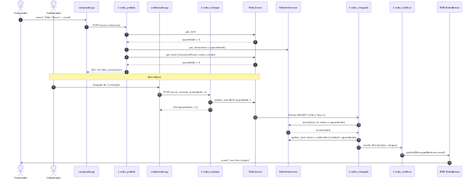

# 1. Onde está o trabalho

- **Conta AWS Academy:** Learner Lab do aluno **Eduardo Vasques Zacour** (eduardo.zacour@gmail.com), curso *AWS Academy Learner Lab* [183838], região **us-east-1**.
- **Repositório:** https://github.com/eduardozacour/sebo-aws (público).
- **Recursos criados:** Lambdas `sebo_pedido`, `sebo_estoque`, `sebo_chegada`, `sebo_notificar` (todas em Python 3.12, 128 MB); tabelas DynamoDB `SeboLivros`, `SeboInteresses`, `SeboVendas`; tópico SNS `SeboAvisos`.

# 2. O que foi implementado

Uma livraria no estilo sebo, sem servidor próprio. O comprador procura um livro pela interface e informa o e-mail.

- **Livro disponível:** o comprador recebe na hora um e-mail pedindo que compareça à livraria para efetivar a compra.
- **Livro em falta:** o pedido fica registrado. Quando o colaborador registra a chegada de exemplares, todos os que esperavam por aquele livro recebem um e-mail.

Tudo fica guardado no DynamoDB para uso posterior: o acervo e o estoque, os interesses com seu estado (`aguardando`, `notificado`, `avisado_disponivel`) e as vendas.

Conforme o enunciado, o cliente já está inscrito no tópico SNS pela console da AWS. A inscrição usa uma política de filtro com o próprio e-mail. Assim o SNS entrega a cada cliente só as mensagens endereçadas a ele.

# 3. Arquitetura

| Componente | Papel |
|---|---|
| `sebo_pedido` (Lambda, Function URL) | Busca de livros e registro de interesse do comprador. Decide entre "disponível" e "aguardando". |
| `sebo_estoque` (Lambda, Function URL) | Operações do colaborador: listar, cadastrar, entrada de exemplares, venda. |
| `sebo_chegada` (Lambda, gatilho do DynamoDB Stream) | Detecta a quantidade passando de 0 para mais de 0 e avisa quem estava aguardando. |
| `sebo_notificar` (Lambda, invocada) | Único ponto que envia e-mail: publica no SNS com o atributo `email`. |
| `SeboLivros` (DynamoDB + Stream) | Acervo e estoque. Chave `livro_id`. |
| `SeboInteresses` (DynamoDB) | Quem quer qual livro. Chave `livro_id` + `email`. |
| `SeboVendas` (DynamoDB) | Histórico de vendas. Chave `venda_id`. |
| `SeboAvisos` (SNS) | Entrega dos e-mails, com filtro por assinante. |
| `comprador.py`, `colaborador.py` | Interfaces de linha de comando em Python (só biblioteca padrão). |

As responsabilidades foram divididas como pede a dica do enunciado. Quem recebe pedidos HTTP não envia e-mail. Quem detecta a chegada não sabe de HTTP. O envio de e-mail fica num lugar só. A chegada é tratada por evento: o colaborador só atualiza o estoque, e o próprio banco dispara o aviso pelo Stream. Por isso o aviso acontece qualquer que seja a forma de atualizar o estoque (interface, console ou carga em lote).

# 4. Fluxos (UML de sequência)

## 4.1 Livro disponível

## 4.2 Livro em falta e chegada

# 5. Concorrência e consistência

Várias Lambdas rodam ao mesmo tempo sobre as mesmas tabelas. Os pontos tratados:

1. **Venda do último exemplar.** Dois colaboradores podem vender o mesmo exemplar ao mesmo tempo. A baixa usa `UpdateExpression` com `ConditionExpression quantidade >= 1`, avaliada atomicamente pelo DynamoDB. Uma das duas vendas recebe `409`. Não há ler-e-depois-gravar.
2. **Entradas simultâneas.** `ADD quantidade :q` é atômico, então duas chegadas ao mesmo tempo não se perdem.
3. **Entrega "pelo menos uma vez" do Stream.** Se a `sebo_chegada` falhar no meio de um lote, o lote é reentregue. Cada interesse passa de `aguardando` para `notificado` com escrita condicional, e só quem ganhou a escrita envia o e-mail. No teste local `test_em_falta_espera_e_avisa_na_chegada`, repetir o evento após um processamento bem-sucedido não gerou novo aviso. Se a chamada assíncrona falhar antes de ser aceita, o interesse pode ficar como `notificado` sem que o aviso seja enviado.
4. **Corrida entre pedido e chegada.** Se o livro chega entre a leitura do estoque e a gravação do interesse, a `sebo_chegada` já rodou sem ver esse cliente. A `sebo_pedido` relê o estoque com leitura consistente depois de gravar e, se o livro chegou, notifica ela mesma, usando a mesma escrita condicional. Como as duas Lambdas disputam a mesma escrita condicional, só uma manda o e-mail (teste local `test_corrida_livro_chega_durante_o_pedido`).
5. **Invocação assíncrona.** `sebo_pedido` e `sebo_chegada` chamam a `sebo_notificar` com `InvocationType=Event`. O comprador não espera a publicação no SNS. Depois de aceitar a chamada assíncrona, o Lambda pode repetir a execução de `sebo_notificar` se ela falhar.

**Decisão de regra de negócio:** quando um livro chega, o sistema solicita avisos para todos os clientes que esperavam pelo livro. Quem chegar primeiro à livraria leva.

# 6. Instalação e operação

O passo a passo completo está no `README.md` do repositório: tabelas, Stream, tópico e inscrição com filtro, as quatro Lambdas com variáveis de ambiente, gatilho e Function URLs, e o uso das interfaces e o roteiro de demonstração. Nenhuma URL, nome de tabela ou ARN está fixo no código: as Lambdas leem variáveis de ambiente e as interfaces leem o arquivo `.env`.

# 7. Testes realizados

Os testes no Learner Lab foram realizados em 18/11/2026, entre 12:34 e 12:38 BRT (us-east-1), pelas interfaces de linha de comando (`comprador.py`/`colaborador.py`) e pelo `teste_concorrencia.py`. Os seis testes locais foram executados em 19/11/2026 sobre o commit `218d60a`. Os horários estão em BRT, salvo indicação explícita. As saídas completas foram guardadas pela dupla.

1. **Pedido de livro com estoque (Dom Casmurro, cliente A).** Esperado: e-mail "disponível". Obtido: resposta `200` "disponível"; e-mail "Sebo: 'Dom Casmurro' está disponível" enviado às 12:35:47 (MessageId `98562e6e…`) e no inbox às 12:35 PM. Evidência: `demo-18-11.txt` (passo 2), `email-avisos-disponivel-18-11.png`, logs do CloudWatch de `sebo_notificar`.
2. **Pedido de livro sem estoque (Vidas Secas, 2 clientes).** Esperado: status "aguardando" na tabela de interesses. Obtido: resposta `200` "em falta"; dois interesses gravados em `SeboInteresses` (status `aguardando`, às 12:35:53 e 12:35:54). Evidência: `demo-18-11.txt` (passos 3 e 4), `dynamodb-18-11.png`.
3. **Chegada de 1 exemplar (Vidas Secas).** Esperado: dois e-mails "chegou" e status `notificado`. Obtido: resposta `200` "Estoque agora: 1" às 12:36:09; `sebo_chegada` registrou `vidas-secas: 0 -> 1` e "clientes avisados neste lote: 2"; o SNS aceitou duas publicações de aviso de chegada (MessageIds `43465aef…` e `2336e5be…`); o cliente A recebeu o aviso; interesses marcados como `notificado`. Evidência: `demo-18-11.txt` (passos 5, 5b, 5c, 5d), logs do CloudWatch de `sebo_chegada` e `sebo_notificar` (JSON), `email-avisos-chegou-18-11.png`.
4. **Duas vendas com 1 exemplar.** Esperado: a 2ª venda recusada com 409. Obtido: 1ª venda `200` (venda `5940a136…`, estoque 0); 2ª venda `409` "sem estoque"; `sebo_chegada` registrou `1 -> 0` com 0 avisados (12:37:43). Evidência: `demo-18-11.txt` (passo 6), logs do CloudWatch de `sebo_chegada`.
5. **12 vendas simultâneas com 4 exemplares (`teste_concorrencia.py`).** Esperado: 4 aceitas, 8 com 409, estoque final 0. Obtido: exatamente 4 aceitas (os logs mostram a sequência 4→3→2→1→0), 8 respostas 409, estoque final 0, entre 12:37:53 e 12:37:56. Evidência: `concorrencia-18-11.txt` e logs do CloudWatch de `sebo_chegada` (JSON).
6. **12 entradas simultâneas de 1 (`teste_concorrencia.py`).** Esperado: o estoque sobe exatamente 12. Obtido: as 12 entradas aceitas, estoque de 0 para exatamente 12 (0→10 numa invocação e 10→12 na outra), 0 clientes avisados. Evidência: `concorrencia-18-11.txt`, logs do CloudWatch de `sebo_chegada` (JSON), `cloudtrail-18-11.png`.
7. **Teste local (`pytest`).** Esperado: 6 testes passam. Obtido: 6/6 passaram em 1.08 s (19/11/2026, commit `218d60a`). Evidência: `pytest-19-11.txt`.

# 8. O que funcionou e o que não funcionou

**Funcionou:**

- Na demonstração de 18/11, o cliente A recebeu o aviso de livro disponível e o aviso de chegada. O sistema registrou dois interesses em Vidas Secas, e o SNS aceitou duas publicações de aviso de chegada. A primeira tentativa de venda do exemplar foi aceita e a segunda foi recusada por falta de estoque.
- No teste de concorrência, quatro das 12 tentativas de venda foram aceitas e oito retornaram `409`. As 12 entradas foram aceitas e o estoque final foi 12.
- O DynamoDB Stream acionou `sebo_chegada` quando o estoque de Vidas Secas passou de 0 para 1.
- Os 6 testes locais passaram (`pytest-19-11.txt`).

**Não funcionou:**

1. **403 na Function URL durante a configuração.** A Function URL retornou 403 durante a configuração, antes do teste das 12:23, que retornou 200. A causa do 403 não foi confirmada.
2. **Assinatura do cliente B pendente no SNS.** A inscrição do cliente B aparecia como pendente no SNS (`rodrigosnrocha@hotmail.com`, "Pending confirmation" no print das 13:50). Sem acesso à caixa dele, não foi possível confirmar a entrega do e-mail de confirmação nem do aviso de chegada.
3. **Limite da janela do lab.** As credenciais da manhã foram canceladas na tarde (16:51, `AccessDeniedException` com deny explícito da policy `voc-cancel-cred`), o que fechou a console e limitou a coleta de evidências (saídas de texto às 12:39, com recheck às 16:51; screenshots entre 13:51 e 16:16).

**Limitações de design:**

- A baixa de estoque e o registro da venda são gravados separadamente. Se a segunda gravação falhar, o estoque pode ser reduzido sem registro da venda.

- A interface é de linha de comando. Não há página web.
- Não há autenticação nas Function URLs (auth NONE, como nos laboratórios da disciplina). Num sistema real a interface do colaborador ficaria protegida (IAM ou Cognito).
- A busca usa `scan`, o que serve para o acervo de um sebo pequeno. Para um acervo grande seria preciso um índice (GSI) ou OpenSearch.
- A inscrição do cliente no SNS é manual (pela console), como o enunciado permite.

# 9. Divisão do trabalho

- **Eduardo Vasques Zacour:** escreveu o código das quatro Lambdas, das interfaces de linha de comando e dos testes; instalou a arquitetura na AWS (Learner Lab) seguindo o próprio `README.md`; rodou a demonstração e o teste de concorrência em 18/11/2026 e coletou as evidências; executou os testes locais em 19/11/2026; redigiu o relatório.
- **Rodrigo Santos Neves Rocha:** participou da demonstração de 18/11/2026 como cliente B (pedido de Vidas Secas) e inscreveu seu e-mail no tópico SNS; revisou o `README.md` e o relatório.

Os dois revisaram todo o código e respondem por qualquer parte.
