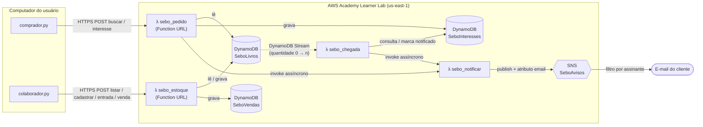
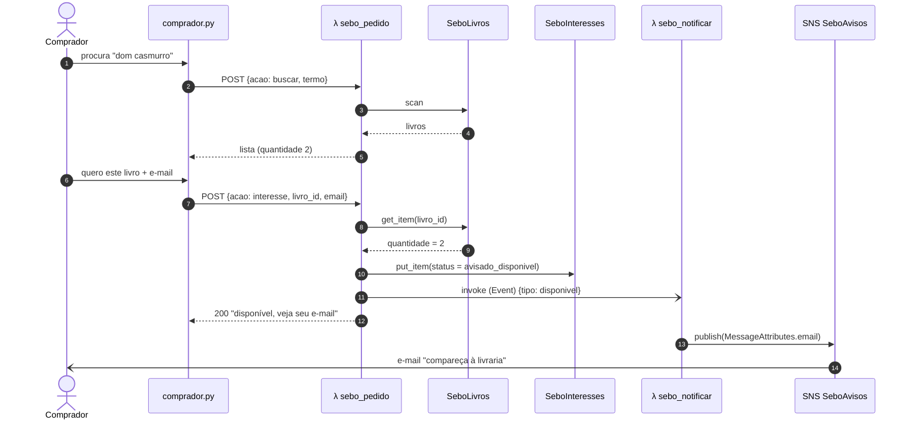
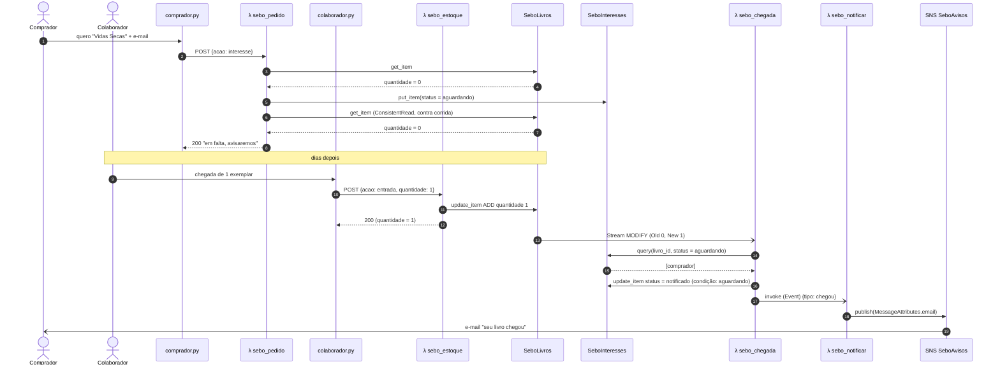

# Diagramas

O GitHub renderiza os blocos Mermaid. Para o PDF do relatório, exportar como PNG:
`npx -y @mermaid-js/mermaid-cli -i docs/diagramas.md -o docs/diagrama.png`
(gera um PNG por bloco: `diagrama-1.png`, `diagrama-2.png`, ...). Se reclamar de Chrome, usar o Chromium do sistema: criar `pp.json` com `{"executablePath":"/usr/bin/chromium","args":["--no-sandbox"]}` e passar `-p pp.json`.

## 1. Diagrama em blocos

## 2. Diagrama de sequência UML: livro disponível

## 3. Diagrama de sequência UML: livro em falta e chegada

